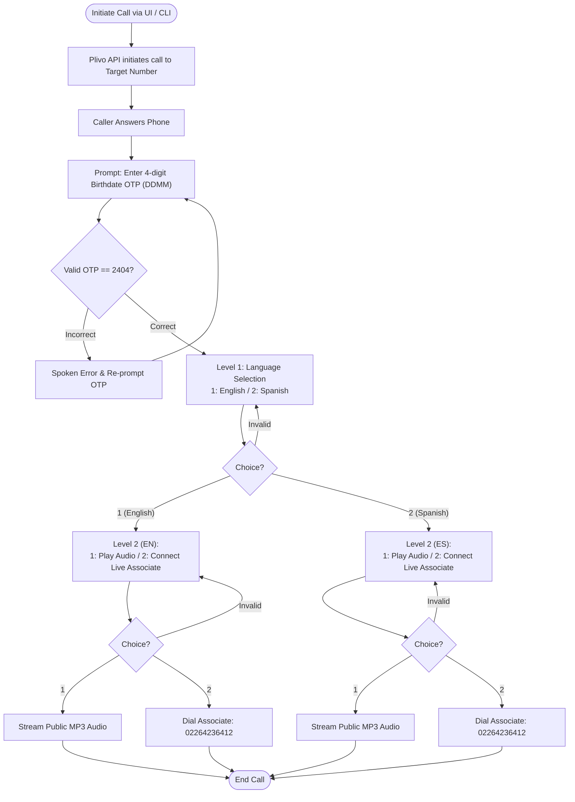

# InspireWorks — Multi-Level IVR System (Plivo Voice API)

A production-ready IVR application demonstrating **Plivo Voice API** capabilities with caller authentication, bilingual branching, media streaming, and call forwarding.

---

## Table of Contents
1. [Overview & Features](#overview--features)
2. [Call Flow Architecture](#call-flow-architecture)
3. [Prerequisites](#prerequisites)
4. [Installation & Setup](#installation--setup)
5. [Configuration (.env)](#configuration-env)
6. [Tunneling with ngrok](#tunneling-with-ngrok)
7. [Running the Application](#running-the-application)
   - [Option A: Web Dashboard (Recommended)](#option-a-web-dashboard-recommended)
   - [Option B: Command Line Interface (CLI)](#option-b-command-line-interface-cli)
8. [Automated Testing](#automated-testing)

---

## Overview & Features

- **Outbound Calling**: Dispatches calls from Plivo source number (`+918035454161`) to any verified target mobile number.
- **DTMF OTP Authentication Layer**:
  - Automatically prompts caller upon answering for a 4-digit birthdate OTP in `DDMM` format.
  - Hardcoded default: **`2404`** (April 24).
  - Looping error handling: If the caller enters an incorrect OTP, the bot announces the failure and re-prompts until the valid OTP is supplied.
  - Caller is strictly blocked from the IVR menu until OTP authentication succeeds.
- **Multi-Level IVR Menu**:
  - **Level 1 (Language Selection)**:
    - Press `1` for **English**
    - Press `2` for **Spanish**
  - **Level 2 (Language-Aware Action Selection)**:
    - Press `1` &rarr; Stream publicly hosted audio message (`Trumpet.mp3`)
    - Press `2` &rarr; Forward call to live associate (`02264236412`)
  - **Graceful Error Handling**: Spoken feedback and automatic menu re-prompts on invalid inputs.
- **Modern Web Dashboard**: Real-time progress stepper and live event viewer tracking caller DTMF inputs and call states.
- **CLI Support**: Direct outbound call initiation from the terminal.

---

## Call Flow Architecture



---

## Prerequisites

- **Python**: `>= 3.10` (Python 3.15 used in this environment)
- **uv**: Fast Python package manager ([install instructions](https://github.com/astral-sh/uv))
- **ngrok**: Tunneling utility to expose local webhooks to Plivo ([download](https://ngrok.com/download))

---

## Installation & Setup

1. **Clone repository & enter directory**:
   ```bash
   cd /path/to/plivo-as
   ```

2. **Install dependencies using `uv`**:
   ```bash
   uv sync
   ```

---

## Configuration (.env)

A ready-to-use `.env` file is present in the project root. You can inspect or update it:

```ini
# Plivo API Credentials
PLIVO_AUTH_ID=MAMTAWMGI0MZCTNTYZZS
PLIVO_AUTH_TOKEN=NDc4YTBiMTQtM2E1MS00ZDBlLWI3YjgtNjQ3NDUw
PLIVO_SOURCE_NUMBER=+918035454161

# Live Associate Number for call forwarding
LIVE_ASSOCIATE_NUMBER=02264236412

# Hardcoded Birthdate OTP in DDMM format (2404 for April 24)
CALLER_BIRTHDATE_OTP=2404

# Public MP3 Audio File URL for Level 2 Option 1
AUDIO_URL=https://s3.amazonaws.com/plivocloud/Trumpet.mp3

# Publicly accessible base URL for Plivo webhooks (updated via ngrok)
BASE_URL=http://localhost:5000

# Local Server Port
PORT=5000
```

---

## Tunneling with ngrok

Plivo requires an HTTPS public endpoint to deliver call answer webhooks and DTMF digits.

1. **Start ngrok tunnel on port 5000**:
   ```bash
   ngrok http 5000
   ```

2. **Copy the forwarding HTTPS URL** (e.g. `https://a1b2-c3d4.ngrok-free.app`).

3. **Update `BASE_URL` in `.env`**:
   ```ini
   BASE_URL=https://a1b2-c3d4.ngrok-free.app
   ```

---

## Running the Application

### Option A: Web Dashboard (Recommended)

1. **Start the Flask server**:
   ```bash
   uv run plivo-as server
   # or
   uv run python main.py
   ```

2. **Open your browser**: Navigate to `http://localhost:5000`.

3. **Trigger Call**:
   - Enter your phone number in E.164 format (e.g. `+919876543210`).
   - Click **"Start Demo Call"**.
   - Watch the live stepper and event log update in real time as you interact with the call on your phone!

### Option B: Command Line Interface (CLI)

You can trigger calls directly via the CLI:

```bash
uv run plivo-as call --to +919876543210
```

---

## Automated Testing

Run the complete test suite verifying XML generation, DTMF verification, branching logic, and Flask webhook handlers:

```bash
uv run python -m unittest discover -s tests
```

Output:
```text
Ran 22 tests in 0.034s
OK
```

